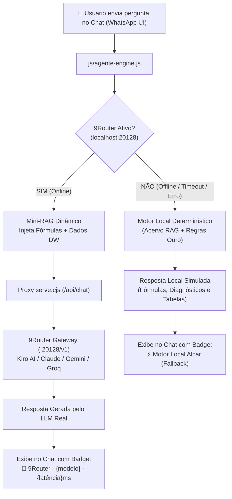

# SAD Usina Alcar — Sistema de Apoio à Decisão com Agente de IA (9Router)

> **Projeto Integrador de Inteligência Organizacional (2º Bimestre)**  
> Protótipo acadêmico para gestão inteligente de suprimentos, previsão de demanda intermitente e política de estoques da Usina Alcar (empresa sucroalcooleira fictícia).

---

## 🌟 Visão Geral da Arquitetura

O sistema conta com um **Agente de IA em formato de Chat estilo WhatsApp**, projetado para responder a dúvidas operacionais e conceituais de analistas de almoxarifado, compradores e gestores.

O agente opera em uma **Arquitetura Híbrida Inteligente com Fallback Automático**, integrando o gateway aberto **9Router** ([9router.com](https://9router.com/#get-started)) a um motor determinístico local.



---

## 🚀 Como Executar o Projeto

Você pode rodar o projeto de duas formas: **Modo Padrão (Sem 9Router)** ou **Modo Avançado (Com IA Real via 9Router)**.

---

### Modo 1: Execução Padrão / Avaliação Acadêmica (Sem 9Router)

Ideal para quando o professor ou avaliador baixar o repositório e quiser rodar tudo imediatamente sem instalar nada adicional:

1. Certifique-se de ter o **Node.js** instalado.
2. No terminal da pasta do projeto, inicie o servidor:
   ```bash
   node serve.cjs
   ```
3. Abra no navegador: **[http://127.0.0.1:4173/dashboard.html](http://127.0.0.1:4173/dashboard.html)** (ou `index.html`).
4. Clique no robozinho verde flutuante (`🤖`) no canto inferior direito.
5. O chat indicará `online [LOCAL]` e responderá com o motor determinístico embutido (100% resiliente, sem falhas).

---

### Modo 2: Execução com IA Generativa Real via 9Router

Permite que o chat da Usina Alcar converse ao vivo com LLMs de ponta (como Claude 3.5 Sonnet, Gemini ou Llama 3):

#### Passo 1: Iniciar o 9Router
Em um terminal separado, execute:
```bash
npx 9router
```
*(O 9Router abrirá automaticamente o painel de controle em `http://localhost:20128`)*.

#### Passo 2: Conectar um Provedor Gratuito no 9Router
No painel do 9Router:
1. Acesse **Providers** no menu lateral esquerdo.
2. Escolha seu provedor:
   - **Kiro AI:** Clique em `+ Add Connection` → escolha **`AWS Builder ID`** → faça login gratuito com seu e-mail (sem necessidade de cartão de crédito).
   - **Google Gemini:** Cole uma chave gratuita gerada em [Google AI Studio](https://aistudio.google.com/).
   - **Groq:** Cole uma chave gratuita gerada em [console.groq.com](https://console.groq.com/).
3. Acesse **Endpoint & Key** no menu lateral para copiar sua **API Key** e o **Model Name** (ex: `kr/claude-sonnet-4.5`).

#### Passo 3: Ativar no Chat da Usina Alcar
1. Com o `node serve.cjs` rodando, abra o painel: `http://127.0.0.1:4173/dashboard.html`.
2. Abra o chat do robozinho (`🤖`).
3. Clique no botão de engrenagem **⚙️** no topo do chat:
   - Clique em **"Testar Conexão"**: ele detectará o 9Router e exibirá a bolinha verde **`Conexão ativa!`**.
   - Verifique o nome do modelo (ex: `kr/claude-sonnet-4.5`).
   - Clique em **Salvar**.
4. O topo do chat agora exibirá **`online [9ROUTER]`** em verde!
5. Envie perguntas livres — a IA responderá contextualizada com as fórmulas e dados reais da usina!

---

## 💡 Perguntas Frequentes: Custos e Tokens no 9Router

> [!NOTE]
> **Preciso pagar alguma coisa ao usar o 9Router?**  
> **Não!** Ao conectar usando opções como **AWS Builder ID (Kiro)** ou chaves gratuitas do Gemini/Groq, você utiliza as cotas de teste gratuitas oferecidas para desenvolvedores.

> [!IMPORTANT]
> **Por que aparece "EST. COST ~$0.01" no painel do 9Router?**  
> Logo abaixo desse valor está escrito: **`Estimated, not actual billing`** *(Custo estimado, não é cobrança real)*.  
> O 9Router **não possui seus dados de pagamento** e não efetua nenhuma cobrança. Esse número é apenas uma métrica teórica que calcula *"quanto essa chamada custaria na API paga oficial da Anthropic/OpenAI"*, servindo apenas como estatística acadêmica de economia.

> [!TIP]
> **E se a cota gratuita do 9Router esgotar durante a apresentação?**  
> Você não fica na mão! O sistema detecta o erro em milissegundos e comuta automaticamente para o motor local simulado (**Fallback Automático**), garantindo que o chat continue respondendo perfeitamente na frente do professor.

---

## 🧠 Como Funciona o Mini-RAG (Injeção de Contexto)

Ao consultar o LLM através do 9Router, o arquivo `js/agente-engine.js` compila dinamicamente um **System Prompt** com as bases teóricas e o snapshot atual da usina:

| Camada | Conteúdo Injetado no Prompt |
| :--- | :--- |
| **Identidade** | Especialista em Inteligência de Suprimentos e Estoques da Usina Alcar (SAD acadêmico). |
| **Fórmula de Estoque de Segurança ($SS$)** | $SS = z \cdot \sqrt{(R + L)\sigma_d^2 + \bar{d}^2\sigma_L^2}$, com fatores de serviço $z$ (95% = 1,645; 99% = 2,326). |
| **Fórmula de Ponto de Pedido ($PP$)** | $PP = \bar{d} \cdot (R + L) + SS$, respeitando o lead time $L$ e ciclo de revisão $R=7$ dias. |
| **Demanda Intermitente** | Método de **Croston (1972)** e correção de viés **SBA (Syntetos-Boylan, 2005)** com multiplicador $(1 - \alpha/2)$. |
| **Acurácia WAPE** | $WAPE = \frac{\sum \|Real - Previsto\|}{\sum Real}$, superior ao MAPE por não explodir com consumo zero. |
| **Desempenho de Entrega** | Métrica **OTIF (On-Time In-Full)**. |
| **Governança & LGPD** | Leitura somente leitura da Camada Ouro (Data Mart), pseudonimização SHA-256 e externalização de conhecimento (SECI de Nonaka & Takeuchi). |
| **Dados em Tempo Real** | Total de itens críticos e em atenção, capital imobilizado, dias de cobertura média, fornecedor com maior atraso recente, chuva dos últimos 7 dias e detalhes dos top 5 materiais em ruptura iminente. |

---

## 🛡️ Proxy Anti-CORS no Servidor (`serve.cjs`)

Navegadores bloqueiam requisições diretas entre portas diferentes (`http://localhost:4173` para `http://localhost:20128`) por políticas de segurança (CORS).

Para solucionar isso de forma nativa e limpa:
- O arquivo [serve.cjs](serve.cjs) possui a rota **`/api/chat`** que atua como um proxy transparente HTTP nativo para o 9Router.
- Inclui a rota **`/api/health-9router`** para checagem rápida de status (ping) sem travar a interface.
- Se o 9Router estiver desligado, o proxy retorna status `503` imediatamente com payload amigável, acionando o fallback local sem atraso perceptível.

---

## 🎨 Interface do Chat Estilo WhatsApp

- **Botão Flutuante Circular (FAB):** Ícone de robô (`🤖`) com badge verde indicador de presença `online`.
- **Cabeçalho:** Nome do agente, status dinâmico (`online` / `digitando...`), tag de rota (`9Router` ou `Local`), botão de ajustes **⚙️** e botão fechar **✕**.
- **Balões de Mensagem:**
  - Usuário (`#d9fdd3`) alinhado à direita com horário e tiques duplos azuis (`✓✓`).
  - Agente (`#ffffff`) alinhado à esquerda com horário e rodapé técnico informando a procedência da resposta:
    - `🤖 9Router · kr/claude-sonnet-4.5 · 380ms` (quando respondido via LLM real).
    - `⚡ Motor Local Alcar (Fallback)` (quando respondido pelo motor determinístico local).
- **Desobstrução Total da Visualização:** As perguntas de atalho ficam organizadas dentro do primeiro balão de boas-vindas, garantindo 100% da altura da tela livre para ler respostas, fórmulas e tabelas, com botão opcional de lâmpada (`💡`) para abrir atalhos sob demanda.

---

## 📂 Estrutura de Arquivos Principais

```
├── dashboard.html          # Dashboard principal independente (6 painéis com foco semântico)
├── index.html              # Home do SAD com KPIs, consumo, risco e clima
├── compras.html            # Tela operacional de compras sugeridas e aprovações
├── decisoes.html           # Registro auditável de decisões e exportação CSV
├── serve.cjs               # Servidor local Node.js + Proxy Anti-CORS (/api/chat)
│
├── js/
│   ├── agente-engine.js    # Motor híbrido da IA: Mini-RAG, integração 9Router e fallback local
│   ├── cabecalho.js        # Ajuste dinâmico de cabeçalho sticky e filtros livres
│   ├── app.js              # Lógica analítica das telas legadas
│   ├── dados.js            # Base simulada das telas legadas
│   └── interface.js        # Interações de gaveta e exportação
│
├── dashboard/
│   ├── dados_alcar.json    # Contrato oficial da Camada Ouro (Data Mart da Usina Alcar)
│   ├── app.mjs             # Controlador modular do dashboard
│   ├── core.mjs            # Cálculos matemáticos, filtros e simulação what-if
│   ├── charts.mjs          # Renderizador vetorial SVG puro dos gráficos
│   └── tokens.css          # Design system e variáveis de layout
│
├── css/
│   ├── chat-consulta.css   # Estilos completos do chat WhatsApp, modal 9Router e badges
│   ├── styles.css          # Estilos gerais do protótipo
│   └── interface.css       # Layout despoluído (filtros não acompanham a rolagem)
│
└── tests/
    └── dashboard.test.cjs  # Testes unitários formais das regras de negócio (100% aprovados)
```

---

## 🧪 Testes e Validação

Para executar os testes de unidade de regras de negócio, contrato de dados e validações matemáticas:

```bash
node --test tests/dashboard.test.cjs
```

Para validar a sintaxe de todos os scripts:

```bash
node --check js/agente-engine.js serve.cjs dashboard/app.mjs
```

---

## 🎓 Conclusão Acadêmica

Este projeto demonstra a aplicação prática de:
1. **Inteligência Organizacional & SECI (Nonaka & Takeuchi):** Externalização do conhecimento tácito do analista em justificativas explícitas auditáveis.
2. **Modelos Quantitativos de Pesquisa Operacional:** Simulação estocástica de incerteza de demanda e lead time, método Croston/SBA para itens intermitentes e mitigação de rupturas.
3. **Engenharia de Software & IA Moderna:** Arquitetura resiliente de Gateway de LLM (9Router), RAG dinâmico e interface conversacional com design system humanizado.
